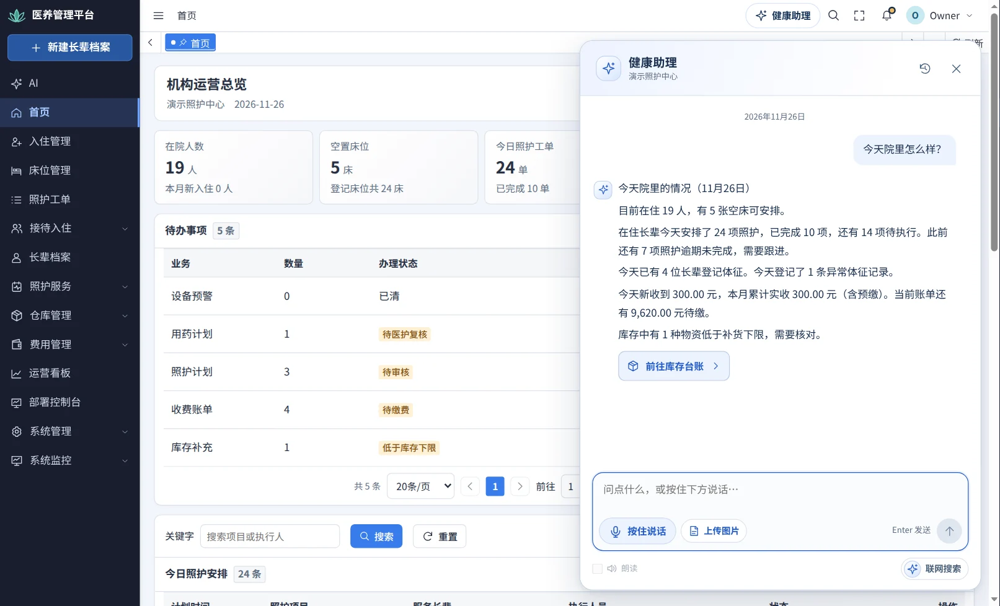

# CareOps Agent SaaS

CareOps is a multi-agent workspace for residential care, including facilities that provide medical care. At handover, staff can ask how the shift went, dictate a care observation or upload paperwork from a medical visit. The assistant can read the records available to the person asking. Staff review and sign drafts in the workspace.

[Documentation](docs/en/README.md) · [Deploy an institution](docs/en/quick-deploy.md) · [Agent handbook](docs/en/agent-handbook.md) · [简体中文](README.md)

## Try a shift handover

| In the workspace | What you can check |
| --- | --- |
| Ask “How are things today?” | Find out how many residents are staying, which care tasks are outstanding, what changes staff have flagged and which payments have come in. The answer follows your account permissions. |
| Open a resident’s daily summary | Read what staff recorded about meals, activities and care. Each part of the summary points back to the signed record. |
| Upload photos from one medical visit or import a registration worksheet | Choose the resident, confirm the document type and check the prefilled fields before saving. |



*Chinese demo with fictional records and a simulated model response.*

DeerFlow runs the lead assistant and the agents that organise visit documents, write daily living summaries and review health observations. Ask about residents to see what staff have recorded, or give a bed number to narrow the scope. After you upload visit documents, open the task list to review the draft against the originals. [Component responsibilities](docs/en/agent-components.md) · [Agent handbook](docs/en/agent-handbook.md)

To follow a request in code, start with the conversation loop. It can call tools up to three times in total for one staff message. For a cross-department brief, the supervisor delegates the authorised care, inventory or finance checks to separate specialists. [Conversation loop](deploy/deerflow/conversation.py) · [Specialist delegation](deploy/deerflow/delegation.py)

## Run locally

On Linux, install Python 3.12+, Git, the SQLCipher development library and Poppler. Run the following commands from the repository root to create a fictional institution in its own database. At the first interactive launch, the terminal asks you to set the password for `owner`.

```bash
python3 -m venv .venv
. .venv/bin/activate
pip install -r requirements-storage.txt -r requirements-payments.txt -r requirements-harness.txt -r requirements-a2a.txt
python3 -m venv .local/deerflow-venv
.local/deerflow-venv/bin/python -m pip install -r deploy/deerflow/requirements.txt
.local/deerflow-venv/bin/python -m pip install --no-deps -r deploy/deerflow/sdk.txt
NH_DEPLOYMENT_LANGUAGE=en python server.py --db .local/careops-demo-en.sqlite3 --initial-data demo --port 8765
```

Open the [local workspace](http://localhost:8765/?workspace=1) to browse the sample records, beds and work orders. Select **AI** or **Health assistant** to start a conversation. Model replies, OCR and voice require an enabled provider. [Service configuration](docs/en/deployment-console.md)

Chat and background tasks use the same DeerFlow v2.2.0 installation. The Owner can check the installed version in the deployment console and trace calls by task in the usage report. For a live institution, start with an empty encrypted database, HTTPS and separate recovery keys. [Worker installation](deploy/deerflow/README.en.md) · [Production deployment](docs/en/quick-deploy.md)

## Find your guide

| Goal | Start here |
| --- | --- |
| Admit a resident, sign care work, handle a payment or arrange a visit | [Staff and family manual](docs/en/workspace-manual.md) |
| Connect MCP tools, reuse skills or publish a read-only A2A capability | [Agent development and integration](docs/en/README.md#agent-development-and-integration) |
| Set permissions, connect devices, back up or upgrade | [Deployment and operations](docs/en/README.md#deployment-and-operations) |
| Prepare a licensed institution for acceptance | [Clinical readiness](docs/en/medical-commercial.md) |

Select the institution’s locale at installation. Additional languages inherit international names, addresses, hospital search and Google Maps. China deployments use Amap. Release testing covers Simplified Chinese and shared, language-independent behavior. [Test scope](AGENTS.md) · [Project log](LOG.md)
