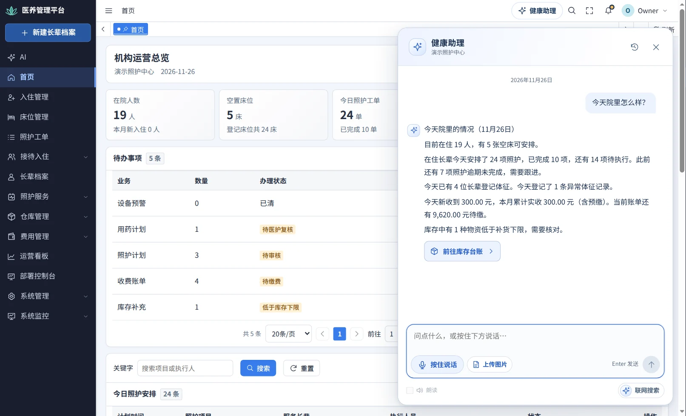

# CareOps Agent SaaS · 智能医养 Agent SaaS 系统

CareOps 是养老机构员工共用的多 Agent 工作台。交班时，院长可以问「今天院里怎么样？」，护工可以口述服药记录，护士可以上传一次就诊的病历和处方。健康助理按当前账号的权限查资料。需要入档时，经办员工在业务页面核对草稿并签认。

[文档导航](docs/README.md) · [部署一家机构](docs/quick-deploy.md) · [接入 MCP 与技能](docs/agent-handbook.md#使用已有-mcp-与社区-skill) · [English](README.en.md)

## 先试一次交班

| 在工作台做什么 | 可以核对什么 |
| --- | --- |
| 问「今天院里怎么样？」 | 助理根据你能查看的台账回答院里住了多少人、还有哪些照护待办、登记了哪些异常，以及收到了哪些款项。 |
| 打开一位长辈的详细档案，选择「近期变化与建议」 | 阅读已记录的用餐、活动和照护情况。点「查看依据」，可以找到每段简报对应的日期和记录。 |
| 上传同一次就诊的照片，或导入登记工作簿 | 选择长辈后，对照原件检查预填字段。就诊照片随病例保存。登记工作簿用来提取待核对的资料。 |



*中文演示工作台。截图中的机构和记录均为虚构，模型答复使用模拟回执。*

健康助理和负责就诊资料、每日生活简报、健康复核的专门 Agent 都使用 DeerFlow 2.x。问「老人们状况如何？」可以看今天已登记的异常和体征覆盖人数。回复完整床号可以只查该床。上传就诊资料后，可以从「整理任务」回来核对草稿。[组件分工](docs/agent-components.md) · [Agent 手册](docs/agent-handbook.md) · [定时巡查](docs/rounds.md)

开发者可以从两处跟进一次请求。员工发来一条消息，DeerFlow 在主对话中根据模型结果安排查询，整条消息累计最多调用三次工具。对于需要跨岗位核对的简报，主管按已授权的计划，把照护、物资或财务资料分给各专员读取。[主对话循环](deploy/deerflow/conversation.py) · [专员委派](deploy/deerflow/delegation.py)

## 本机启动

在 Linux 上准备 Python 3.12+、Git、SQLCipher 开发库和 Poppler。在仓库根目录运行以下命令，演示机构会使用单独的数据库。首次交互启动时，按终端提示为 `owner` 设置密码。

```bash
python3 -m venv .venv
. .venv/bin/activate
pip install -r requirements-storage.txt -r requirements-payments.txt -r requirements-harness.txt -r requirements-a2a.txt
python3 -m venv .local/deerflow-venv
.local/deerflow-venv/bin/python -m pip install -r deploy/deerflow/requirements.txt
.local/deerflow-venv/bin/python -m pip install --no-deps -r deploy/deerflow/sdk.txt
python server.py --db .local/careops-demo.sqlite3 --initial-data demo --port 8765
```

打开[本机工作台](http://localhost:8765/?workspace=1)，可以先浏览演示档案、床位和工单。点击左栏 **AI** 或右上角的 **健康助理** 开始对话。模型答复、OCR 和语音都需要开通相应服务。[服务配置](docs/deployment-console.md)

对话和后台任务都使用上面独立安装的 DeerFlow v2.2.0。Owner 可在「部署控制台」核对实际安装版本，在用量明细查看每项任务产生的调用。正式部署时，为机构准备空白加密库、HTTPS 和独立恢复密钥。[DeerFlow 安装步骤](deploy/deerflow/README.md) · [正式部署](docs/quick-deploy.md)

## 继续阅读

| 你要做的事 | 从这里开始 |
| --- | --- |
| 办理入住、签认照护、收费退款或处理家属来访 | [员工与家属使用手册](docs/workspace-manual.md) |
| 接入 MCP 工具、复用社区技能、开放 A2A 只读能力 | [Agent 开发与协议导航](docs/README.md#开发与接入-agent) |
| 管理权限、部署设备、备份或升级 | [机构部署与运维导航](docs/README.md#部署与运维) |
| 评估项目能否在持证医养机构上线 | [交付与验收](docs/medical-commercial.md) |

部署时选定机构语种。新增语种默认沿用国际姓名、地址、全球医院目录及 Google Maps，中国版使用高德。项目发布回归只运行中文版及语言无关的公共能力。[测试约定](AGENTS.md) · [维护日志](LOG.md)
