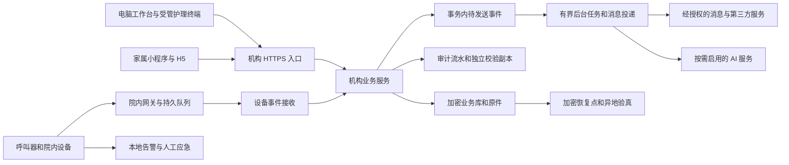

# 医养管理平台机构版商用设计

[文档导航](README.md)

适用对象为约 200 床的养老机构，覆盖单院及同一机构的多院区。代码核对基线为 `49f0be2`，设计日期为 2026 年 11 月 25 日。下文标出的交付项和性能指标用于排期及签认，当前可运行能力以代码基线为准。[上线验收清单](commercial-acceptance.md)

## 产品边界与交付顺序

- **商用基础版**覆盖档案、床位、员工、照护、药品、收费、安全应急、权限审计、备份、离线补录和运维。签约范围内的家属端与设备协议随基础版交付。关闭 AI、AI 套餐到期或外网不可用时，院内人工操作和本地应急链继续运行。
- **AI 增值版**按机构开通语音结构化、交班纪要、声学风险线索、工单跟进和知识库。套餐及凭据由平台侧管理，机构 Owner 管理本机构开关、发起人范围、用量上限与告知授权。AI 产生草稿、线索或受规则约束的建议，临床、财务与告警关闭由具权人员执行。
- **首发部署**采用单机构私有化。每家机构使用独立数据库、加密密钥、备份位置和服务账号。总部和分院共享租户标识，数据访问按院区、区域和职责隔离。统一托管 SaaS 是单独验收的部署选项。
- **商用产品范围**剔除长护险和纯政务报送。产品配置贯穿菜单、URL 直达、服务端命令、导出、API、助手目录、搜索和定时作业。护理、交班、事件、床位和财务业务报表继续交付。历史政务数据保留受控查阅和迁移路径，按保管政策处置。
- **实现顺序**先完成档案保管、空间、权限审计、工单、交班和紧急呼叫，再交付日常护理、药品批次与双人复核、膳食、账务、网关和对外协同。增值功能独立上线。药品、离线及灾备仍是商用签收门槛，实现顺序由[验收清单](commercial-acceptance.md)定义。

## 电脑工作台与角色入口

| 工作区 | 日常操作 |
| --- | --- |
| 值班总览 | 首屏显示当班待办、临近超时、未响应告警、入住及床位空缺。左侧按业务分组，顶部始终显示当前院区及当班范围。待响应的紧急事件在工作台上持续可定位，查看详情后可返回原筛选。 |
| 入住管理与床位 | 简易档案显示常用登记与照护摘要，详情页保留登记资料、医疗资料和时间线。房间、床位、长辈及工作单可双向打开。床位表、平面图和按区域筛选共用同一份床位台账。 |
| 护理与药品 | 护工查看当班工单、照护记录、膳食及交接班。具权人员分别处理评估、医嘱、领药和复核。待签认卡显示长辈、床位、依据、记录时间和下一步，签认后展示正式凭证。 |
| 安全与设备 | 告警中心按当前班次和等级展示未响应、已响应、待处置与待复核。事件详情集中展示原始信号、地点、时效、通知回执及响应记录。设备页按院区、在线状态和床位筛选，保留绑定历史。 |
| 财务、人员与系统管理 | 财务在费用账单、流水、押金和对账中追到凭证。Owner 与授权主管在设置中管理组织、人员、岗位、流程配置、审计、数据恢复和版本。运维页显示设备与队列状态，获取业务内容需另行授权。 |
| 健康助理与家属端 | 启用 AI 时从工作台右上角进入健康助理，回答附有权限的业务详情或已筛选入口。表单保存仍使用业务确认。家属独立登录 H5 或小程序，从已绑定长辈进入通知、探视、留言和账单。 |

## 服务结构与数据边界

| 约束 | 设计 |
| --- | --- |
| 部署与性能 | 保留现有模块化业务服务、SQLCipher 和服务端命令。事件、投递、药品和工作流优先用有索引的关系表。网关与消息适配器通过有界任务隔离 CPU、内存和外部超时。私有化首期按实测保留单机构单写主库，达到持续锁竞争、恢复时间或数据规模门槛再评估独立数据库服务。 |
| 组织和数据归属 | `tenantId → campusId → buildingId → floorId → roomId → bedId` 是空间主键路径。区域树在同一栋楼内管理，可关联楼层、房间和护工职责。医生、护理、行政、后勤、财务与运营账号使用同一身份目录。住户当前归属与事件发生时归属分别保存。 |
| 业务命令 | 每次写入由服务端计算操作者、有效范围和适用规则。带业务版本和幂等编号的命令在一事务内落业务记录、操作审计及必要的待发送事件。连接中断后的安全重试返回同一业务凭证。跨院区搬迁、排班换人、权限变更以当前版本重新核验。 |
| 重复与故障 | 后台任务至少一次拉取，接收端用业务唯一键去重。按对象维持必要版本顺序。处理失败有重试、最后错误、停滞时长和授权重放。紧急事件保留专用接入与通道配额，OCR、导出、备份和外部模型使用独立限流预算。 |
| 时间与证据 | 业务日期按机构时区。保存明确的发生时间、服务端收到时间、正式入账时间及确认时间。离线和设备时钟的差异保留标记。原件、签认、审批、外部回执与规则版本用稳定编号引用。敏感附件仍受独立权限。 |
| 升级迁移 | 先建立可兼容读的新增结构和迁移扫描，再用副本校对记录数、主键、金额和附件摘要。灰度用独立机构或影子库。正式切换只保留一个主写入方。上线前建恢复点并演练版本回退及切换窗口内数据如何补录或重放。 |

## 一、基础业务底座

| 功能 | 当前代码 | 商用设计 |
| --- | --- | --- |
| 长辈档案 | 基础登记、家属与原件、试住、正式入住、换床、退住及评估记录已有可运行流程。当前评估追加历史并归档旧计划。 [档案](dossier.md) · [评估计划代码](../platform_core/care/plans.py) | 基础信息、既往病史、药物过敏、在用药、饮食禁忌、家属及紧急联系人进入结构化档案。将试住、入住、转区、退住、协议期满区分为业务事件。住户协议独立编号、关联原件、签署方、生效与到期日期。批准评估冻结量表版本、分项原值、评分、签认与原件，纠错追加更正版。支持能力评估、压疮与跌倒风险模板。批量导入先预检、去重及模拟映射，正式提交有逐行结果。授权打印与导出使用同一版本。 |
| 床位和房间 | 分层看板、区域、床位分配与换床已有。房间可编辑床位数并保留稳定编号。 [空间和床位](facility.md) | 将床位占用、长辈去向和床位可分配情况分字段。长期外出、临时外出保留入住关系，隔离、维修、停用按权限限制分配。床位台账带发生时的房间编号。批量调整先展示冲突及授权边界，逐条有变更回执。转床和取消占用在同一事务更新，拒绝并发双占床。 |
| 人员、排班及交班 | 有岗位授权、分院和区域、员工合同、工资日、排班及人员签收交班。现有排班仍有姓名字段。 [账号和交班](access.md) · [排班代码](../platform_core/operations/resources.py) | 岗位任命、班次、区域职责和考勤事件绑定员工 ID。排班模板、缺岗补位、跨班交接、考勤异常与更正可追溯。仅可向已激活且在授权范围内的员工指派。总部可按授权汇总，分院只能读本院和获准协作范围。 |
| 工单闭环 | 现有照护工单主要是待执行和已完成，已有执行者记录、部分质检、定时派发。 [工单代码](../platform_core/care/plans.py) | 同一流转服务处理照护、保洁、维修和送药。来源可为手动、告警、家属申请和定时计划。流程为待接单、处理中、待复核、完成或驳回。每步记录操作者、岗位、时间和签认凭证，退回后保留旧过程再提交。自动派发使用可辨识的系统主体并保存规则。送药工单可关联药品核对凭证。 |
| 计划照护 | 已有按日和按星期计划、周菜单、到点派发及同日补派。 [定时工单](scheduled-work.md) | 评估方案产生版本化个人计划，涵盖机构批准的每若干小时、每日多时段、重复星期和临时改班。执行实例以计划版本、长辈和计划时刻唯一。事项有到点提醒、超时告警、跳过原因、补做凭证，转区时未完成任务按明确交接规则移交。跨日故障恢复后列出待补核的任务。 |

能力评估可采用现行推荐性国家标准 GB/T 42195-2022。护理负责人须对本机构使用的量表、压疮和跌倒风险模板、题目版权及评分规则逐版审定。住户档案退住后可退出日常列表，在保管期内按审批查阅并禁止进入例行 AI 生成。 [国家标准 GB/T 42195-2022](https://std.samr.gov.cn/gb/search/gbDetailedCNF?id=F159DFC2A7E247EFE05397BE0A0AF334)

## 二、照护业务核心

| 功能 | 当前代码 | 商用设计 |
| --- | --- | --- |
| 护理记录 | 已有体征、生活时间线、进食、服药核对和 ASR。 [照护时间线](care-timeline.md) · [语音配置](media.md) | 血压、血氧、体温、血糖带单位及来源。皮肤、进食、排泄、情绪按结构化选项登记并支持说明。记录关联长辈、当时床位、工单与责任人。人工与设备通过相同提交校验，更正追加凭证。语音可以填护理草稿，人员核对后保存。 |
| 药品和发药 | 已有医嘱复核、给药、床旁逐人签认与床位卡。通用库存以品目和数量为主。 [床旁用药](medication-rounds.md) · [通用库存代码](../platform_core/operations/resources.py) | 独立管理药品目录、批号、规格、库位、数量单位、效期和来源。个人自带药按长辈单独保管。入库、领药、发药、归还、作废与盘点均记流水，效期和禁用状态限制领用。用药计划、发出、实际给予、漏服和退回能追到人、批号与秒级时间。高危药品名单由授权岗位版本化审定，需要双人时两个独立在岗账号分别签认。高危、过期、召回、错人或错批的拒绝事件留证。 |
| 膳食管理 | 已有按星期三餐菜单、当日替代、逐位实际进食和备注。 [伙食工单](scheduled-work.md) | 食谱和菜单项统一编号，特殊饮食、过敏和禁忌来自档案审核值。订餐按人和餐次记录类别、份量与送餐方式，菜单变更重新核查禁忌。统计预订、实际参加、实际菜品、未食及特殊餐数量。 |
| 费用和收款 | 已有账期核算、现有账单提醒、预缴和押金冲抵、付款订单及渠道回调。正式月账单仍有人工生成入口。 [经营与结算](finance-reports.md) | 按床位费、护理费、餐费、耗材及增值服务计价，各费用项保留规则、来源和精度。按约定账单日自动出单，同一账期只生成一次正式账单。保留预缴优先冲抵、自担手续费、押金单独台账、差价与补收。退住结算、部分退款、原路退款、票据及红冲均由权限和对账控制，异步渠道重复回执以凭证去重。 |

账单日默认为入住日期对应的月日，可在入住时调整。短月到期采用该月末日，后续长月恢复原约定日。无固定合同期限与账期互相独立。每一笔实际到账、费用、押金、预缴、退款与核销应能从原单逐级追到支付或人工凭证。

## 三、安全、应急与统一告警

当前设备流程支持疑似跌倒或持续卧床信号、去重、分配、护士复核与入档。床头呼叫、卫生间紧急呼叫、逐级升级、统一告警分级和通道回执需要完整实现与现场验收。 [现有设备契约](integrations.md) · [现有复核代码](../platform_core/gateways/__init__.py)

- **呼叫闭环**记录来源设备、地点、当时床位分配、普通或紧急类型、原始发生时间、服务器收到时间、首个响应人、响应耗时和处置过程。流程为接收、响应、处置、复核归档。已读与响应各自记账，响应耗时按接入端记录及可校准设备时间核对。
- **升级与交班**用当前班次、岗位、区域和备用联系人计算通知对象。到达机构配置的各级时限仍未响应时，按护工、组长、院长顺序升级。缺岗或通道不可用时切换已配置备用人和备用通道。响应后停止未发生的接单升级，仍可对处置超时单独告警。床旁声光和人工应急在主服务或外网故障时仍可用。
- **不良事件**处理跌倒、呛咳、压疮、走失和突发不适。按初报、补充事实、原因分析、整改、复核、归档推进。记录发现时间、处置人、责任部门、证据和整改期限。允许同一告警关联事件与工单。复核人员看到原记录和更正，归档报告可独立打印。
- **分级告警中心**统一接入雷达、呼叫机、烟感、水浸、计划任务超时、药品效期和欠费。等级为一般、重要、紧急，规则按机构、区域、类别及版本配置。企微、飞书、短信与 APP 分别登记发送、送达回执、失败及下一次重试，站内保留待办和已读人。外部消息只包含最少必要说明及经授权入口。
- **告警门禁**紧急呼叫、跌倒和消防等受保护类型始终能产生记录并触发本地路径。申请抑制的范围、原因、期限、审批人与恢复时间均留痕。按规定权限审批，超期自动恢复。重复传输按事件 ID 去重，新的紧急按钮动作保留独立事件。设备确认、通知送达、人员响应及事件归档各有凭证。

院方依据现行强制性 GB 38600-2019 和本机构应急预案确认安全规则、设备交接和演练。系统保留应急证据及联系人，紧急现场处置与必要对外报告由院方执行。 [国家标准 GB 38600-2019](https://std.samr.gov.cn/gb/search/gbDetailed?id=9B70B85563E89A1BE05397BE0A0A4C9A) · [养老机构管理办法第 31 条](https://www.ahq.gov.cn/jczwgk/jczwgk_qbj/jczwgk_ylfw/jczwgk_ylfw_ssqk/202410/t20241031_2443177.html)

## 四、设备接入与事件契约

现有集成目录提供适配器和数据契约，未接通端口明确返回未连接。首发网关按 MQTT 为主、HTTP 和 Modbus 兼容实施。选定供应商的真实型号、固件和现场网络需要联调。 [现有接口代码](../server.py) · [MQTT 5.0 标准](https://docs.oasis-open.org/mqtt/mqtt/v5.0/os/mqtt-v5.0-os.html) · [Modbus 协议](https://www.modbus.org/modbus-specifications)

| 层 | 交付设计 |
| --- | --- |
| 适配器 | 床头呼叫、卫生间按钮、毫米波雷达、门磁、烟感、水浸、智能工牌和体征设备都走同一适配器接口。每种设备登记型号、固件、能力、离线判断、字段映射版本和验收用例。MQTT 按设备/网关身份及主题限制，HTTP 校验身份、消息版本与重放，Modbus 由院内网关执行隔离轮询。消防等设备原生应急链由设备侧继续工作。 |
| 管理 | 设备唯一编号、分院、网关、房间、床位和绑定版本。支持单个与批量导入、绑定预览及解绑。记录在线、离线、低电、心跳、故障、维修、退役及恢复。批量操作展示受影响的楼栋、床位和使用中的信号路由。绑定缺失或映射矛盾的信号进入待核队列，紧急信号按院方定义转入已知网关所属区域的人工确认。 |
| 统一事件 | 每条事件包含 `schemaVersion`、`eventId`、`sourceEventId`、`tenantId`、`campusId`、`deviceId`、`roomId`、可空 `bedId`、`bindingVersion`、`kind`、`severity`、`occurredAt`、`receivedAt`、`sequence` 或设备启动批次、`correlationId` 和限长业务载荷。机构身份及空间从认证和绑定解析。业务只消费统一事件，原始协议与原帧限制在接入侧。 |
| 可靠交付 | MQTT 的传输确认和业务入库回执分开核对。网关持久化事件后响应设备，平台在事件、关联告警及待发送记录落库后返回业务回执。重发按来源和事件 ID 幂等，状态变化使用绑定版本和可核对的序号。已确认的紧急事件在边缘保留到可验证恢复点覆盖，容量不足提前通知值班人员。 |
| 运维交接 | 每个厂商交付协议版本、事件对照表、样本、测试账号、支持窗口和升级影响说明。设备失联、掉电重启、时钟漂移、换床、解绑、乱序和网络恢复逐项验收。代际兼容以网关适配器验证，核心业务状态机保持一致。 |

## 五、权限、审计与数据安全

| 功能 | 当前代码 | 商用设计 |
| --- | --- | --- |
| 权限控制 | 已有服务端岗位权限、分院/房间约束、实名签署临时编辑授权。 [权限代码](../platform_core/access_policy.py) · [临时申请](access.md#临时档案编辑申请) | 在岗位之外约束租户、院区、区域、班次和数据对象。病历查看、用药编辑、复核、账单导出、告警处理、审批屏蔽、更正与档案处置分别授权。敏感病历查看或水印导出可要求事由、时限和二人审批。Owner 管理机构设置，护理及财务职责按角色发放。生产运维通过限时授权排查并单独审计。 |
| 完整审计 | 现有业务版本与操作流水记录操作者、对象或房间，部分原件与业务包已有访问记录。 [操作审计](../platform_core/activity.py) · [变更历史](history.md) | 记录身份、角色、任职范围、操作时间、可信客户端 IP、请求编号、对象主键、版本、结果及审批。覆盖敏感读取、拒绝、修改、更正、处置、导出、下载、授权和恢复。应用账号只能追加审计。按机构分段计算摘要并签名到独立副本，结合只追加存储验证替换和删除。IPv4/IPv6 和代理链按可信反向代理解析。审计摘要避免记录完整身份证号、联系方式和医疗正文。 |
| 保管与隐私 | 现有 60 天字段变更回溯、365 天退住日常档案清理及加密原件。 [现有归档清理](../platform_core/care/archive_retention.py) | 先识别法定档案、合同、业务凭证、运行日志、备份和普通线索各自期限。养老机构长辈信息档案及服务协议等适用资料的保管期按协议期满后不少于五年设计。365 天仅可作为日常列表收起策略，适用数据继续加密保管。签认版本及审计按各自政策保留。迁移先暂停旧清理，再盘点存量，已清理资料从获准快照核对重建并记录缺口。 |
| 备份与恢复 | 现有每日整库加密快照、异地回读校验、导入预检和更新前保护点。 [加密备份](backups.md) | 业务数据和独立审计分别产生加密副本。业务每 12 小时至少一个可独立恢复的时间点，本机与异地各一份，另做升级前保护点。支持后台设置时间、存储目标、校验、导入导出及恢复演练。压缩在加密前完成，业务与审计由各自保管策略控制过期。可恢复时间以异地验证成功点的实际时间衡量。恢复后重新核验外部交易、紧急事件和待发送水位。 |

对医疗健康等敏感信息配置最少字段、授权访问、脱敏和导出水印。对依法需单独同意的处理留存授权证据，委托处理、对外提供、云端 AI 和可能的境外提供按适用情况完成事前评估及备案或签约要求。建立查阅、更正、删除请求与安全事件响应流程。法定保管期、争议保全和备份过期分别管理。 [养老机构管理办法第 32 条](https://www.ahq.gov.cn/jczwgk/jczwgk_qbj/jczwgk_ylfw/jczwgk_ylfw_ssqk/202410/t20241031_2443177.html) · [个人信息保护法第 28–30、47、51、55–57 条](https://www.samr.gov.cn/zw/zfxxgk/fdzdgknr/bgt/art/2023/art_f374e8245320413181742e6d1baf4366.html)

## 六、对外协同与业务交付件

| 功能 | 当前代码 | 商用设计 |
| --- | --- | --- |
| 家属端 | 已有绑定授权、照护进度、受控医嘱和简报、缴费提醒及部分服务评价。小程序为 H5 容器。 [家属权限](../platform_core/portal.py) · [多端说明](clients.md) | 微信小程序及 H5 支持通知、探视申请与改期、留言和回复、完整账单以及经住户授权的紧急通知。仅展示绑定长辈白名单字段，关系撤销立即失效。涉及真实微信能力时用机构 AppID、正式业务域名和真机验收。家属付款通过独立授权订单入口，金额与绑定关系由服务端核对。 |
| 打印导出 | 已有床头卡打印、加密凭证和部分 CSV 流程。 [文件保护](storage.md#业务文件) | 提供护理台账、交班、不良事件、床位占用与财务对账单 XLSX 和 PDF。按查询范围锁定数据版本、字段、日期和生成时区。列最小化、数据脱敏、水印、限时下载，创建与下载都重新鉴权。财务汇总可追到源凭证，电子表格处理以公式符号开头的外部文本。 |
| 可交付资料 | 已有分院、备份、版本、客户端及工作台操作说明。 | 按机构交付部署清单、权限矩阵、操作手册、供应商对接表、业务报表样张、恢复演练记录、培训签收和服务支持窗口。历史导出由院方确定用途与授权。 |

## 七、扩展集成与 AI 增值

对外集成按独立的 OpenAPI 合同管理。定义 `/openapi/v1` 资源、最小权限的机构服务账号、数据字段白名单、分页、速率配额、幂等键、版本过渡期及 Webhook 签名与回执。HIS 和体检机构按双方签认的身份匹配规则、外部编号、时间、单位与原件授权接入。支付沿用现有微信与支付宝订单及回调校验，由实际商户验收签约、回调、退款和对账。发票服务约定开具、复核、红冲和申请失败处理。 [现有渠道和账单](finance-reports.md)

| 增值能力 | 当前代码 | 商用增值设计 |
| --- | --- | --- |
| ASR 与结构化草稿 | 已有转写、语音整理、朗读、就诊和简历 OCR，以及部分语音待确认动作。 [识别与朗读](media.md) | 口述转护理记录草稿，显示原话、待填字段、时间、床位与重复记录提示。人工明确选择目标、修改并确认。普通开表单保持手填。保留供应商、账期、员工和功能计量，优先使用字典与确定性语音整理。 |
| 交班 AI 纪要 | 已有人工作业交班及可核对的护理简报。 [交班与 Agent](agent-runtime.md) | 授权录音转写后按事实、待办、风险分段，附原话片段及发言来源。签收人与经办人确认后生成正式交班文档。原件按录音授权和保管规则管理。 |
| 异常声音和异构感知 | 有咳嗽试验脚本和疑似跌倒复核。 [咳嗽试验脚本](../observe_cough.py) | 咳喘及异常声音作为有时间窗的风险线索，按院区确认设备和采集范围。按实际场景核对误报、漏报、爆发告警及设备不可用。临床判断和紧急告警保留人工、物理呼叫与硬件规则路径。 |
| Agent 工单跟进 | 已有区域只读工具、审核动作、定时工单与巡查简报。 [Agent 运行时](agent-runtime.md) | 业务规则先受理设备告警及已核实的事件，并按条件生成工单。Agent 可汇总、建议分派及提醒，使用工单和事件编号关联。系统记录输入事实、工具回执、确认人及执行版本。模型超时或套餐不可用时按业务规则照常派发。 |
| MCP、Hook 与知识库 | 已有工具目录和若干预留适配契约。 [工具契约](../platform_core/agents/contracts.py) | 工具按用户及范围签发最小能力。Hook 接收脱敏事件与回执，按目标审批约束审查输出。知识库支持护理规范、饮食禁忌及操作 SOP，保存来源、版本、生效期、发布人和检索权限。答案附来源，同一岗位看到获准材料。 |

## 八、商用交付与运维

| 功能 | 设计与启用条件 |
| --- | --- |
| 私有化与多租户 | 首发使用机构内 Linux、TLS 反代、独立服务账号和 SQLCipher。平台升级签名密钥、机构业务密钥、外部服务凭据分别保管。SaaS 启用前验收第二租户，隔离业务库、备份、缓存、对象路径、队列与监控，运营人员的跨租户调试临时授权并留痕。 |
| 配置化 | Owner 和业务主管按权限配置量表、工单模板、流程、告警规则、收费项目、接待时段与备份位置。配置带版本、生效日期、预览、审批与回退。紧急路径和临床核对守卫由服务端保持，日常业务配置可在测试环境回放。 |
| 灰度和升级 | 复用现有签名发布、升级前加密快照、启动门禁和失败回退。增加试点/稳定通道、供应商协议兼容、数据库读写就绪及队列水位检查。升级失败按预案恢复，成功后核查设备、支付回执和监督日志。 [现有升级能力](updates.md) |
| 日志与运维面板 | 按系统、业务审计、设备、外部投递与模型用量记录。按机构、请求编号、设备编号与时间关联。监控 CPU、RSS、磁盘和 WAL、接口调用量、延迟与错误、备份年龄、设备在线、待办和重试最老年龄。健康页区分存活、可写、队列及备份。运维权限和业务权限分开。 |
| 外网中断 | 院内局域网仍可接达机构服务时，登录、护理、床位、工单、给药及本地呼叫按既有规则运行。暂存需外发的消息和对账，网络恢复后按幂等编号发送。紧急通知按设备本地声光和人工应急预案继续。 |
| 终端失联 | 已登记受管终端仅保存最少必要的离线护理草稿，使用平台设备保护与本地加密，设数量和有效期。同步时重新核验账号、院区、班次、床位归属、业务版本和重复。冲突留在人工队列并显示原因。设备本地时间与服务端入账时间并列。正式医嘱核签、发药双人确认、支付结算和权限审批恢复联机后办理，院方应急可按批准的纸质流程先处置并复核补录。 |
| 服务交付责任 | 院方签认组织、岗位、护理、告警升级、档案期限和应急预案。开发交付方负责软件、备份恢复工具、监控、升级和问题响应。硬件、通信和收款供应商提供实测回执与维护范围。合同附故障分级、值守方式、恢复目标和退出/交接流程。 |

2 GiB、2 vCPU 的 Debian/KVM 检验已验证版本 `49f0be2` 的 498 项后端测试，以及 32 路模拟上传时的内存限制和过载响应。该基线记录应用压力进程峰值 68 MiB、2 份上传成功、30 份返回 503。200 床生产容量需按真实设备、主机、局域网、业务量和配置进行独立[验收](commercial-acceptance.md#容量恢复与故障演练)。

## 开发增量与退出条件

| 增量 | 交付切片 | 退出条件 |
| --- | --- | --- |
| 1 · 数据与权限 | 先单独迁移档案保管规则、数据归属、敏感读写审计与旧数据盘点，再接入住、床位和评估版本。 | 通过 B01–B03、R01、R02 的迁移和回归。在隔离副本上演练回退。 |
| 2 · 执行与应急 | 用当班工作台把排班、交接、通用工单状态机和调度串成第一条可执行路径。按首发呼叫设备打通持久接收、通知、响应和归档。 | 通过 B04–B06、S01、S02；首批设备具备台账和断网演练记录。 |
| 3 · 照护与收费 | 在同一业务身份体系下接护理记录、个人药品批次、核对发药、膳食、月账单及押金结算。 | 通过 C01–C04，照护、药房和财务各核对一组端到端凭证。 |
| 4 · 交付与协同 | 补齐设备接入、统一告警、家属、报表、外部 API、灾备和运维。新增服务先接第一个真实供应商，再验收替换契约。 | 通过剩余必验及签约联调，完成 200 床容量、断网和空机恢复演练。 |
| 5 · 增值发布 | 开通签约的语音、交班、感知和 Agent 能力。按需交付集中托管。 | 按选配场景验收，复跑关闭增值能力时的关键业务。 |

每个增量以独立发布与回归场景收尾。量表或设备供应商待定时，可先在测试环境完成相应流程的模拟验收，再按签认的量表或签约的设备型号和配置做联调签收。
