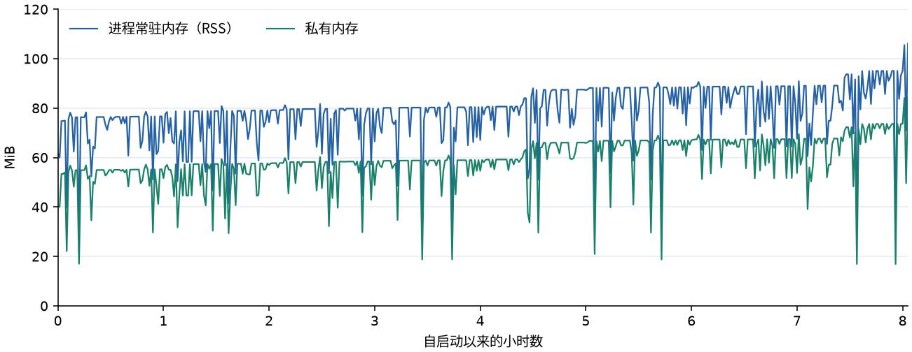

# 200 床实测报告 · 2026 年 11 月 25 日

**状态：按要求提前停止。** 北京时间 13:06:45 启动，21:10:27 停止，实际负载时长 **8 小时 3 分 42 秒**。截至停止，到期的 378 份工单全部派达，当天已生成的一份加密备份可在空目录恢复。服务内存仍呈上升趋势。24 小时稳定性和跨日备份均未得到验证。

## 环境与负载

| 项目 | 实测条件 |
| --- | --- |
| 服务版本 | [854b518](https://github.com/ReFac/smart-elderly-care/commit/854b518529dc41dbfdafac90f41e7f43014c096a)，当天电脑端 UI 重构前的基线 |
| 虚拟机 | Debian，2 vCPU，分配 2 GiB 内存，客体识别 2,027,020 KiB，无交换空间 |
| 数据 | 模拟机构，200 床、180 位在住、29 条定时计划 |
| 读 | 每 4 秒同时请求工作台快照、业务版本和助理导航版本 |
| 写 | 每 3 分钟写入一条带独立标识的模拟体征记录 |
| 取证 | 每分钟采集服务进程内存和客体可用内存。停止负载后核对数据库和备份包，再正常关闭专用虚拟机 |

## 内存

| 指标（MiB） | 起始 | 全程中位数 | 末次采样 | 采样峰值 |
| --- | ---: | ---: | ---: | ---: |
| 常驻内存 RSS | 61.68 | 79.63 | 106.10 | 106.10 |
| 按比例分摊共享页的 PSS | 48.45 | 66.59 | 92.89 | 92.89 |
| 私有内存 | 40.26 | 58.70 | 84.68 | 84.68 |

共 484 次采样，覆盖 13:06:45 至 21:09:45，最大间隔 60.001 秒。内核记录的进程 RSS 高水位为 **108.04 MiB**，客体可用内存最低 **1,607.61 MiB**，OOM 杀进程次数为 **0**。可逐分钟复算。[原始数值 CSV](soak-200-beds-2026-11-25-partial.csv)

| 负载小时 | RSS 中位 MiB | PSS 中位 MiB | 私有内存中位 MiB |
| --- | ---: | ---: | ---: |
| 1 | 76.28 | 63.08 | 54.87 |
| 2 | 76.45 | 63.35 | 55.44 |
| 3 | 79.56 | 66.34 | 58.15 |
| 4 | 80.18 | 66.97 | 58.76 |
| 5 | 80.62 | 67.42 | 59.63 |
| 6 | 88.16 | 74.96 | 66.76 |
| 7 | 88.66 | 75.45 | 67.25 |
| 8 | 89.05 | 75.86 | 67.69 |

跳过首小时预热，对第 2 至第 8 个完整小时的中位数做线性拟合，每小时各 60 个样本，尾段 4 个样本只计入总览。RSS 平均趋势为 **+2.29 MiB/小时**，PSS 为 **+2.28 MiB/小时**，私有内存为 **+2.25 MiB/小时**。第 5 至第 6 小时的上升最明显。内存在这次观测中尚未稳定，这些进程级数据无法定位增长来自业务数据、分配器留存或泄漏。

## 请求与落库

最后一次负载计数在停止前约 6 秒写盘。其覆盖的 7,255 轮并发读取和 162 次写入均无调度遗漏，485 次床位一致性检查通过。以下为已持久化的请求统计，P95 取直方图区间上界。

| 接口 | 记录请求 | HTTP 200 | P95 上界 |
| --- | ---: | ---: | ---: |
| 工作台快照 | 7,256 | 7,256 | 50 ms |
| 业务版本 | 7,255 | 7,255 | 10 ms |
| 助理导航版本 | 7,255 | 7,255 | 10 ms |
| 提交体征记录 | 162 | 162 | 50 ms |

停止后再次只读核验，162 个写入标识从 0 到 161 连续且各出现一次，每条都关联到预定的长辈。数据库内仍为 200 床、180 人入住。

## 定时工单

按截止时刻重算应派计划，并逐人比对派发回执和工单。**11 批应派 378 份，实际 378 份，漏派、重复、名单外工单均为 0。** 派发延迟中位数 4 秒，最大 9 秒。

| 预定时间 | 项目 | 应派 | 实派 | 延迟秒 |
| --- | --- | ---: | ---: | ---: |
| 13:08 | 小时巡查 01 | 2 | 2 | 5 |
| 14:08 | 小时巡查 02 | 2 | 2 | 6 |
| 15:08 | 小时巡查 03 | 2 | 2 | 7 |
| 16:08 | 小时巡查 04 | 2 | 2 | 9 |
| 17:08 | 小时巡查 05 | 2 | 2 | 0 |
| 17:30 | 晚餐 | 180 | 180 | 0 |
| 18:08 | 小时巡查 06 | 2 | 2 | 1 |
| 19:08 | 小时巡查 07 | 2 | 2 | 2 |
| 20:08 | 小时巡查 08 | 2 | 2 | 3 |
| 20:30 | 晚间巡查 | 180 | 180 | 4 |
| 21:08 | 小时巡查 09 | 2 | 2 | 5 |

## 备份与恢复

服务启动时为当日时段创建了 **1 份自动全量备份**，首次成功，密文大小 **1,249,356 字节**。停止后将这份文件冷恢复到独立临时目录，核对了业务修订 29、200 张床、180 位在住长辈及 29 条计划定义。该快照采于当日首批派发前，恢复点内的本轮派发数为 0，符合其捕获时间。

测试在次日零点前结束，因此无法据此判断跨日自动备份和之后的工单；本次也未验证异地网盘副本或 200 人同时在线的场景。
